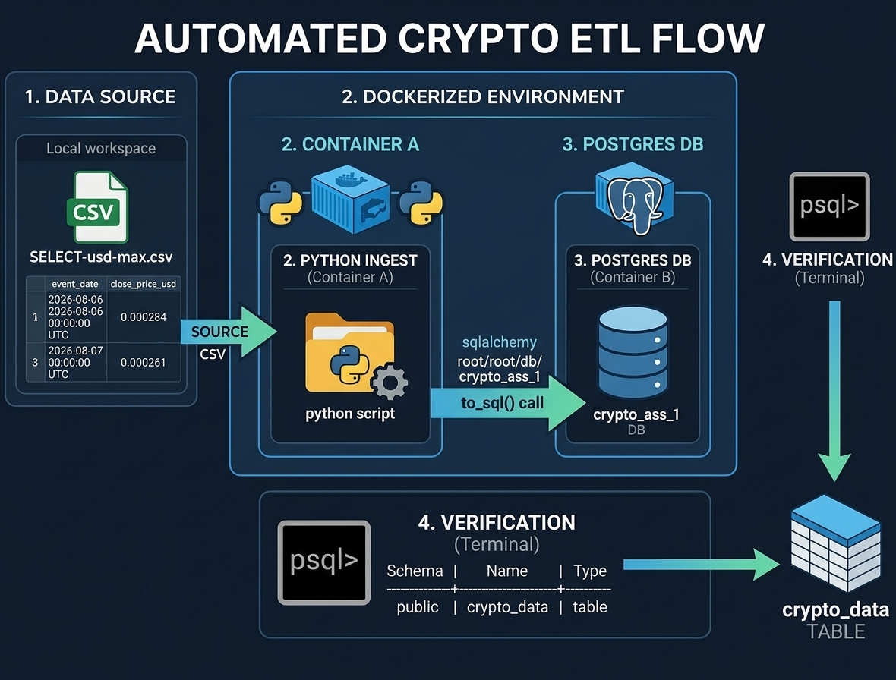

# Analytic Sage DE

A lightweight data engineering project that ingests cryptocurrency market data from a CSV into PostgreSQL using Docker and Python. The project is designed to automate a simple ETL workflow: load raw data, infer the schema from the CSV, create a table in PostgreSQL, and append the records for downstream analytics.

## Architecture



## Overview

This repository contains a small end-to-end data pipeline for cryptocurrency market data from [CoinGecko](https://www.coingecko.com/), stored in `SELECT-usd-max.csv`. The workflow uses:

- Python for the ingestion job
- `pandas` to read and transform the CSV
- `SQLAlchemy` to connect to PostgreSQL
- Docker Compose to run PostgreSQL and the ingestion service together
- environment variables for configuration

The resulting table is named `crypto_data` and includes fields such as:

- `event_date`
- `close_price_usd`
- `market_cap_usd`
- `volume_usd`

## Project structure

```text
.
├── .env
├── .gitignore
├── .python-version
├── 01_Docker-L1/
├── Dockerfile
├── README.md
├── docker-compose.yaml
├── ingest.py
├── pyproject.toml
├── SELECT-usd-max.csv
├── uv.lock
└── .venv/
```

### Key files

- `ingest.py` — reads the CSV, creates the PostgreSQL table schema, and loads the data
- `docker-compose.yaml` — defines the PostgreSQL and ingest services
- `Dockerfile` — builds the Python ingestion environment
- `SELECT-usd-max.csv` — source dataset for the ETL process
- `.env` — local environment configuration used by the loader

## Dataset

The source CSV contains historical cryptocurrency market data sourced from CoinGecko. The pipeline loads the file as provided; it does not retrieve data directly from the CoinGecko API. The file has the following columns:

```csv
event_date,close_price_usd,market_cap_usd,volume_usd
2026-08-06 00:00:00 UTC,0.0002841647496683723,-1,324827.2237042091
2026-08-07 00:00:00 UTC,0.0002609448673607608,0,38071.728391038094
```

## Prerequisites

Before running the project, make sure you have:

- Docker and Docker Compose installed
- Python 3.13+ (if running locally outside Docker)
- `uv` for dependency management

## Configuration

The ingest script loads environment variables from `.env` and connects to PostgreSQL using those values.

Example `.env`:

```env
POSTGRES_USER=root
POSTGRES_PASSWORD=root
DB_HOST=db
DB_PORT=5432
POSTGRES_DB=crypto_ass_1
```

## Running with Docker

From the project root, start the database and ingestion job:

```bash
docker compose up --build
```

This will:

1. Start a PostgreSQL container
2. Build the ingestion container from the Dockerfile
3. Run `ingest.py`
4. Create the `crypto_data` table
5. Insert all records from the CSV into PostgreSQL

To inspect the imported data:

```bash
docker exec -it postgres-container psql -U root -d crypto_ass_1 -c "SELECT * FROM crypto_data LIMIT 10;"
```

To follow the ingest logs:

```bash
docker compose logs -f ingest
```

## Running locally

If you prefer to run the ETL without Docker, start PostgreSQL separately and then run:

```bash
uv sync
uv run python ingest.py
```

This assumes the database is reachable using the values in `.env`.

## How the ingestion works

The loader script does the following:

1. Loads environment variables using `python-dotenv`
2. Builds a PostgreSQL connection string with SQLAlchemy
3. Reads `SELECT-usd-max.csv` using `pandas.read_csv()`
4. Creates an empty table schema from the DataFrame (`df.head(0).to_sql`)
5. Appends all rows to `crypto_data` with `to_sql(..., if_exists="append")`

## Example output

The script prints progress messages while running, such as:

```text
Step 1: Loading environment variables...
Step 2: Reading CSV file...
CSV read successfully! Rows: 123
Step 3: Creating empty table schema...
Empty table created with schema!
Step 4: Appending full data...
Data successfully appended to the table!
```

## Notes

- The project is intentionally simple and suited for local data engineering experiments or early-stage analytics workflows.
- It can be extended to include validation checks, schema normalization, automated scheduling, or pipeline orchestration.
- The database name, user, and password can be adjusted in `.env` and `docker-compose.yaml` to match your environment.

## License

This project is provided as-is for educational and experimental use.
